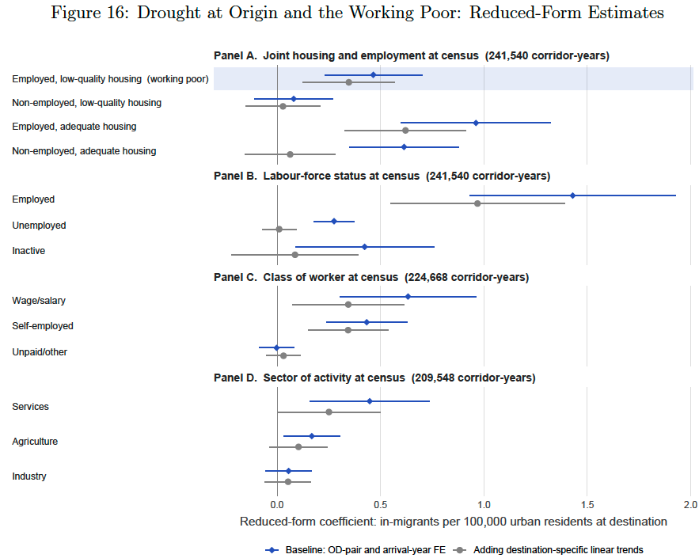
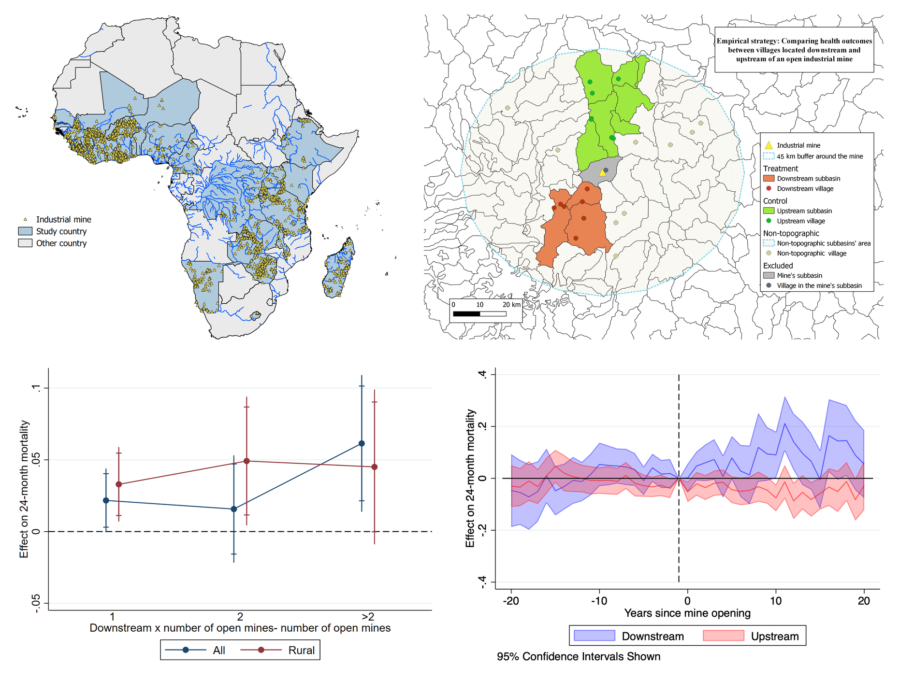
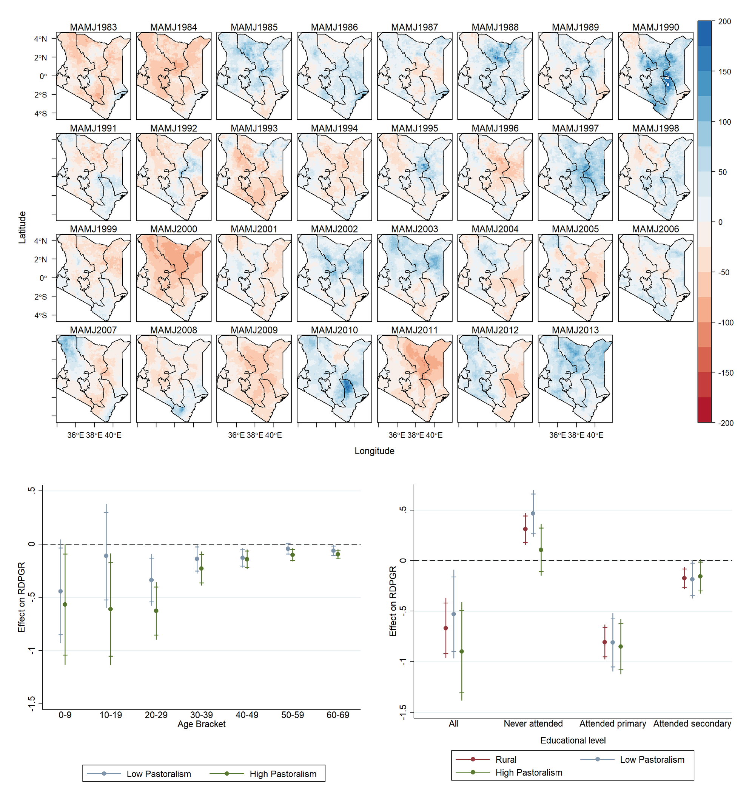

<h2 style="font-size:1.15em; font-weight:400; color:#557B7C; letter-spacing:0.02em; margin-top:1.6em; margin-bottom:0.8em; padding-bottom:0.3em; border-bottom:1px solid rgba(140,21,21,0.22);">Job Market Paper</h2>

[Working, but in Slums: Climate Migration and Integration in Urban Africa](../files/Gittard_JMP2026.pdf) (with [Eleanor Wiseman](https://www.eleanorwiseman.com/)) - *Job Market Paper*

  
Abstract and figure

  

    

      

        How do climate-induced migrants integrate into African cities?
        We construct annual bilateral migration flows across eight African
        countries from harmonized census microdata covering 1981–2018,
        linking migrants’ retrospective migration histories to their
        housing and employment conditions at destination. We exploit
        variation in drought exposure at origin along the same migration
        corridors and use instrumental-variable estimates to characterize
        urban integration relative to the additional migration associated
        with drought. We find that climate-responsive migration increases
        the number of migrants who work but remain in low-quality
        housing—the urban working poor. In our baseline estimates, 85%
        of the drought-associated inflow into low-quality housing is
        employed, compared with 61% among those in adequate housing.
        More broadly, for every hundred additional migrants associated
        with drought, approximately twenty-eight are observed in
        low-quality housing, amounting to roughly 110,000 people across
        our sample. These residential consequences are particularly
        pronounced in small and secondary cities, rather than large
        metropolitan areas. Our findings reveal an important tension in
        climate adaptation: migrants can participate in urban labor
        markets without necessarily gaining access to adequate housing,
        particularly in rapidly growing secondary cities where housing
        deprivation is already widespread.
      

    

    
<figure class="paper-figure">
  
</figure>

  

<h2 style="font-size:1.15em; font-weight:400; color:#557B7C; letter-spacing:0.02em; margin-top:1.6em; margin-bottom:0.8em; padding-bottom:0.3em; border-bottom:1px solid rgba(140,21,21,0.22);">Revise & Resubmit</h2>

[MiningLeaks: Water Pollution and Child Mortality in Africa](../files/MiningLeaks_Gittard_2026.pdf) (with [Irène Hu](https://hu-irene.github.io/))  - *Revise & Resubmit, Journal of Development Economics* · [PSE Working Paper No. 2024-24](https://www.parisschoolofeconomics.eu/en/publications-hal/miningleaks-water-pollution-and-child-mortality-in-africa/)

  
Abstract and figure

  

    

      

        In the midst of Africa's mining boom, communities downstream from industrial mines face increased exposure to toxic waste, yet the causal impact of mining-induced water pollution on local health remains unquantified at the continental scale. We construct a novel dataset of opening dates for 2,016 industrial mines and combine it with child health outcomes from the Demographic and Health Surveys spanning 1986 to 2018 across 26 African countries. Using a staggered difference-in-differences design comparing villages located downstream and upstream—based on hydrological networks—of mines before and after their opening, we find a 25% increase in 24-month mortality downstream after mine opening, relative to upstream areas where mortality rates remain stable. The effect is concentrated among children who were no longer breastfed after six months, consistent with the protective role of breastfeeding against heavy metal ingestion through contaminated water and with exposure to heavy metals rather than microbial contamination. Effects are stronger during active mine operation, at high international mineral prices, and in densely mined regions, and decrease with distance from the mine, consistent with higher mining intensity generating higher pollution levels. We rule out alternative mechanisms including changes in fertility behaviors, access to healthcare, in-migration, conflict, and income effects. These findings underscore the significant local health impacts of industrial mining and highlight the need for stronger environmental regulation and water quality monitoring in resource-rich developing countries.
      

    

    <figure class="paper-figure">
      
      <figcaption>
        Industrial mines, hydrological identification strategy, and estimated effects of downstream exposure on child mortality across Africa. Click to enlarge.
      </figcaption>
    </figure>
  

[Women and Climate Adaptation in Rural Sub-Saharan Africa: Constraints and Research Priorities](../files/Delavallade_Gittard_Vaillant2026.pdf) (with [Clara Delavallade](https://sites.google.com/site/claradelavallade/) and [Julia Vaillant](https://scholar.google.com/citations?user=UukWzp0AAAAJ&hl=fr))  *Revise & Resubmit, World Development* · [World Bank Policy Research Working Paper No. 11095](https://openknowledge.worldbank.org/entities/publication/eefc27a2-cd54-44bb-a9b3-256efa73786f)

<h2 style="font-size:1.15em; font-weight:400; color:#557B7C; letter-spacing:0.02em; margin-top:1.6em; margin-bottom:0.8em; padding-bottom:0.3em; border-bottom:1px solid rgba(140,21,21,0.22);">Working Papers</h2>

<strong>Climate and the Global Food Supply</strong>
(with Jennifer Burney, Nathalie Lambrecht, Rosamond Naylor,
Siddharth Sachdeva, Eleanor Wiseman and Pascal Polonik)
— <em>Preliminary draft (2026)</em>

  
Abstract

  

    

      This project investigates how climate change affects global
      agricultural production beyond the major staple crops traditionally
      studied. Combining national and subnational crop yield data with
      high-resolution climate data, we develop climate damage functions
      across a broad range of crops. We estimate the effects of
      historical climate shocks on agricultural yields, project future
      climate impacts, and investigate how differences in crop
      vulnerability translate into risks for global food and nutrient
      supplies. By examining the diversity of agricultural production,
      the project aims to provide a more comprehensive assessment of
      climate-related risks to food security.
    

  

[Droughts, Migration and Population in Kenya](../files/GITTARD2024a_WP.pdf) — *PSE Working Paper* · *Special Mention, FAERE 2021 · Best Poster Award, ClimRisk2020*

  
Abstract and figure

  

    

      

        Since 2000, Kenya has experienced an increase in the frequency of droughts, significantly affecting agriculture and driving labor force migration. This paper investigates strategic migration patterns among farmers and pastoralists in response to repetitive droughts. I use fine-grained data that capture short-distance migration and heterogeneity, combining satellite-based daily rainfall data from CHIRPS with exhaustive censuses from 1989, 1999, and 2009. I use a two-way fixed-effects model to exploit spatial variation in drought frequency across 2,518 sub-locations, comparing their demographic growth according to the number of dry rainy seasons over each decade. First, I show that increased drought frequency triggers out-migration: one additional drought decreases demographic growth by 1.7 percentage points, equivalent to a 1% population decline. This result holds within the 15–65 age group, excluding other demographic effects and confirming migration as the driving factor. The main contribution of this paper is the identification of different migration strategies across livelihoods. Rural areas dominated by pastoral activities experience significant out-migration, generating a rural-rural shift from pastoral to agriculture-oriented regions. Herders’ migration displays little heterogeneity, suggesting the migration of entire households and consistent with migration as a last resort. Agricultural areas are less vulnerable to drought and display significant heterogeneity. The results show the migration of the most educated working-age individuals, while uneducated individuals remain trapped in affected areas. This paper highlights the importance of detailed data for understanding diverse migration strategies and designing effective policies.
      

    

    <figure class="paper-figure">
      
      <figcaption>
        Long-rains anomalies and heterogeneous demographic responses to drought across pastoral and agricultural areas in Kenya. Click to enlarge.
      </figcaption>
    </figure>
  

[Impacts of Repetitive Droughts and the Key Role of Experience: Evidence from Nigeria](../files/GITTARD2024b_WP.pdf) - *PSE Working Paper*

[Climate Resilient School Meals](https://fsi9-prod.s3.us-west-1.amazonaws.com/s3fs-public/2025-11/RF%20Climate%20Resilient%20School%20Meals%20Report%20-%20Draft.pdf) (with Jennifer Burney, Rosamond Naylor, Nathalie Lambrecht, Siddharth Sachdeva and Eleanor Wiseman) - *FSE Working Paper*

<h2 style="font-size:1.15em; font-weight:400; color:#557B7C; letter-spacing:0.02em; margin-top:1.6em; margin-bottom:0.8em; padding-bottom:0.3em; border-bottom:1px solid rgba(140,21,21,0.22);">Work in Progress</h2>

Climate Shocks, Food Security and Market Prices in Africa: The Role of Supply Chains (with [Eleanor Wiseman](https://www.eleanorwiseman.com/)) - *New draft coming soon!*

Do Buildings Save Lives? Evaluating the Health Benefits of France’s Residential Energy Efficiency Programs During Extreme Heat Events (with Marshall Burke, Andrew Wilson and Christopher Callahan)

From Farms to Meals: Food Markets and Seasonal Scarcity in Kenya (with [Eleanor Wiseman](https://www.eleanorwiseman.com/))

Industrial Mining, Migration, and Rural Transformation in Africa

<h2 style="font-size:1.15em; font-weight:400; color:#557B7C; letter-spacing:0.02em; margin-top:1.6em; margin-bottom:0.8em; padding-bottom:0.3em; border-bottom:1px solid rgba(140,21,21,0.22);">Publications in Other Fields</h2>

[Analysis of Psychiatric Disorders by Age Among Children Following a Mass Terrorist Attack in Nice, France, on Bastille Day, 2016](https://jamanetwork.com/journals/jamanetworkopen/fullarticle/2800940) (with Florence Askenazy, Nicolas Bodeau, Ophélie Nachon, Michèle Battista, Arnaud Fernandez and Morgane Gindt)  
*JAMA Network Open, Vol. 6, No. 2, February 2023*

<h2 style="font-size:1.15em; font-weight:400; color:#557B7C; letter-spacing:0.02em; margin-top:1.6em; margin-bottom:0.8em; padding-bottom:0.3em; border-bottom:1px solid rgba(140,21,21,0.22);">Pre-doctoral Publications</h2>

[Climate Change and Migrations: Remittances as a Buffer?](https://www.cairn.info/revue-mondes-en-developpement-2017-3-page-85.htm) (with Olivier Damette)  
*Mondes en Développement, No. 179, March 2017*
